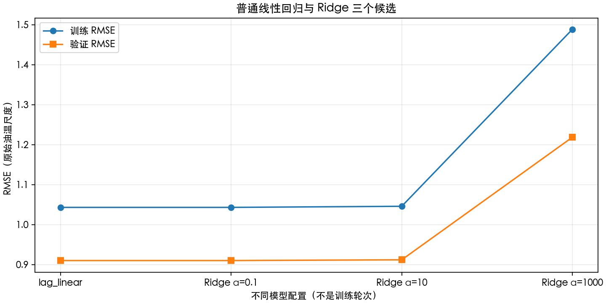
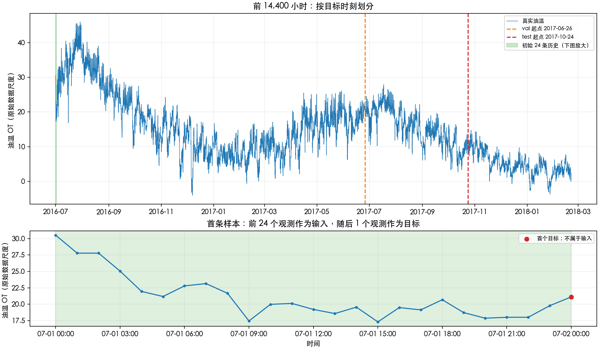
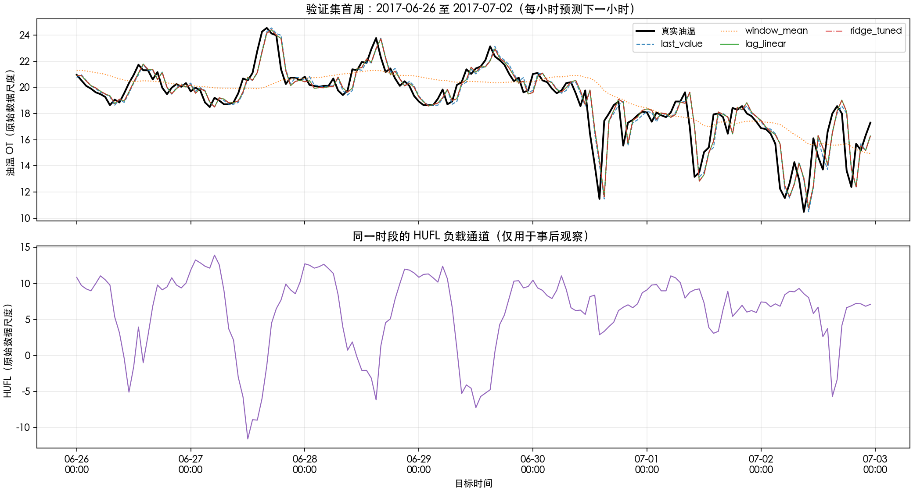

# 第六周：变压器油温预测与序列窗口

本实验使用过去 24 条小时油温预测下一小时。完成窗口构造、三个基线、Ridge 三候选调参、时间划分、结果核对和场景分析。所有数值来自实际运行，不使用测试结果选择模型。

## 1. 数据来源与环境

- 官方项目：[ETDataset](https://github.com/zhouhaoyi/ETDataset)。
- 原始文件：[ETT-small/ETTh1.csv](https://github.com/zhouhaoyi/ETDataset/blob/main/ETT-small/ETTh1.csv)，原样保存于 `data/ETTh1.csv`，未归一化、插值或改写。
- 下载地址：`https://raw.githubusercontent.com/zhouhaoyi/ETDataset/main/ETT-small/ETTh1.csv`。
- 原始文件有 17,420 条小时记录，2016-07-01 00:00:00 至 2018-06-26 19:00:00。实验使用前 14,400 条，即 2016-07-01 00:00 至 2018-02-20 23:00。
- SHA-256：`f18de3ad269cef59bb07b5438d79bb3042d3be49bdeecf01c1cd6d29695ee066`。可用此摘要核对下载内容。
- `date` 用于时序检查、划分与对齐；`OT` 同时作为历史输入和下一小时目标；`HUFL` 仅用于结果图中的事后观察，不输入模型。其余五个负载通道本周不使用。
- 运行环境：Python 3.12.15，NumPy 2.2.5，pandas 2.3.3，scikit-learn 1.7.2，Matplotlib 3.10.6。
- `load_data` 检查必要列、时间有效且递增、无重复、相邻间隔一小时，以及所有数值列有限。读取失败就报错，不自动填补数据。

## 2. 运行方法

在仓库根目录，使用已有环境：

```bash
.venv/bin/python week06/run_windows.py
.venv/bin/python week06/run_baselines.py
.venv/bin/python -m unittest discover -s week06 -p test_core.py -v
```

或在已经激活 Python 环境后：

```bash
cd week06
python -m pip install -r requirements.txt
python run_windows.py
python run_baselines.py
python -m unittest test_core -v
```

两个入口分别可运行，实践二不依赖先运行实践一。路径相对入口文件解析，运行时的当前目录不会改变数据位置。导入组件不会启动实验。运行会更新 `results/` 内对应结果。

## 3. 代码职责和调用关系

| 文件 | 接收什么 | 负责什么、返回什么 |
| --- | --- | --- |
| `data.py` | CSV 路径；一维序列、窗口长度；窗口与时间边界 | 读取校验后的表格；返回 X、y、target_index；返回各时段样本字典 |
| `models.py` | 原始窗口 X；Ridge alpha | 固定规则返回预测；构建带 StandardScaler 的独立回归管道 |
| `evaluation.py` | 真实值、预测；保存文件与原始数据 | 计算 MAE/RMSE；复核落盘的指标、索引、时间和真值；独立检查线性数值计算 |
| `reporting.py` | 已计算的记录、表格和原始时序 | 保存 CSV、绘制三张 PNG，不训练、不调参 |
| `run_windows.py` | 前 12 条记录、L=3/5 | 组织短序列实验，打印核对并保存 16 条窗口记录 |
| `run_baselines.py` | 集中的窗口、时段、路线、候选配置 | 数据准备 → 训练及验证选择 → 最终预测和评价 → 保存及核对 → 绘图 |
| `test_core.py` | 手工可推算的小例子 | 检查窗口数值、边界历史、重叠划分拒绝、误差公式和标准化统计量保持不变 |

数据流：`load_data → make_windows → split_by_target → fit(仅训练) → predict → regression_metrics → save_csv / plot_*`。

## 4. 实践一：从历史到样本

设目标下标为 t，窗口长度 L。`X[row] = series[t-L:t]`，`y[row] = series[t]`，`target_index[row] = t`。切片左闭右开，所以最后一个输入是 t-1，目标 t 不在输入中。每列从旧到新排列。总记录 N 条时，t 从 L 到 N-1，共 N-L 条样本。

前 12 小时并非一直下降：例如 05:00 的 21.174000 回升至 06:00 的 22.792000，再至 07:00 的 23.143999；09:00 的 17.445999 之后也有回升。

以 L=3 第一条样本为例：输入 2016-07-01 00:00、01:00、02:00，数值约 `[30.531000, 27.787001, 27.787001]`，目标是当天 03:00 的 25.044001。原始目标下标为 3。预测时前三个观测都已获得，03:00 的值只作为后来核对的答案。

| L | X / y / target_index 形状 | 首条输入 → 目标（2016-07-01） | 末条输入 → 目标 | 行数 |
| --- | --- | --- | --- | --- |
| 3 | (9,3) / (9,) / (9,) | 00:00–02:00 → 03:00 | 08:00–10:00 → 11:00 | 9 |
| 5 | (7,5) / (7,) / (7,) | 00:00–04:00 → 05:00 | 06:00–10:00 → 11:00 | 7 |

L 从 3 改为 5 后，每条样本的特征增加 2 个，可用样本减少 2 条，首个可预测目标推迟 2 小时，末个目标仍是 11:00。3/5 个小时观测的首尾时间差分别为 2/4 小时；最后一个输入到目标始终差 1 小时，预测步长没有变化。

`window_examples.csv` 每行是一条样本：`window_size` 是 L；`input_start=t-L`；`input_end=t-1` 是实际包含的最后下标；`target_index=t`；`target_time=date[t]`；`input_values=X[row]` 存为 JSON 列表文本；`target_value=y[row]`。全部来自函数返回值，没有另写一套窗口逻辑。

例如第一行 L=3，input_start=0、input_end=2、target_index=3，对应原始 CSV 的前 3 条数据作为输入、第 4 条数据作为答案（CSV 表头不计入数据行）。程序检查输入时间全部早于目标、输入和标签与原序列一致，且两组分别 9/7 行，共 16 行。

## 5. 实践二：固定预测场景和时间划分

固定 L=24、单步目标、前 14,400 条、仅使用 OT、目标不标准化。先在完整使用范围内构造 14,376 条窗口，再按目标时间左闭右开划分：

| split | 目标时段起点（包含） | 目标时段终点（不包含） | 样本数 |
| --- | --- | --- | --- |
| train | 2016-07-01 00:00 | 2017-06-26 00:00 | 8616 |
| val | 2017-06-26 00:00 | 2017-10-24 00:00 | 2880 |
| test | 2017-10-24 00:00 | 2018-02-21 00:00 | 2880 |

最初 24 条只能形成历史，所以训练首个目标为 2016-07-02 00:00。掩码逐条累计，要求每个可用目标恰好归组一次。

- 首条验证样本：输入 2017-06-25 00:00–23:00，目标 2017-06-26 00:00。输入来自训练时段。
- 首条测试样本：输入 2017-10-23 00:00–23:00，目标 2017-10-24 00:00。输入来自验证时段。
- 首条验证目标原始下标为 8640，真实值约 20.962999。`sample_window_trace.csv` 列出了原始下标 8616–8639 的完整 24 条输入，可逐条回查 CSV。

边界之前的历史在预测时已知，可以使用。如果先截取三段再分别构造窗口，会使验证、测试各丢失前 24 条本来可以预测的目标，三部分样本数变成 8616/2856/2856。

本周评价方式是每小时获得真实观测后再预测下一小时。因此预测 2017-10-24 01:00 时，可以使用当天 00:00 的真实油温；如果站在 10-23 23:00 一次性预测未来 120 天，这些未来实测值还不存在，就不能这样使用。新观测成为输入不意味着模型重新 fit。

## 6. 三种基线及 Ridge

方法参考：[scikit-learn Ridge 官方说明](https://scikit-learn.org/stable/modules/generated/sklearn.linear_model.Ridge.html)。

- `last_value`：`X[:, -1]`，沿用最近观测。没有训练参数。
- `window_mean`：`X.mean(axis=1)`，逐行平均 24 条历史。没有训练参数，较早的高值或低值都会影响结果。
- `lag_linear`：`StandardScaler → LinearRegression`。在训练窗口上拟合标准化和权重；预测使用相同列顺序与训练统计量。24 个历史位置是 24 个不同特征。
- `ridge_tuned`：`StandardScaler → Ridge(alpha)`。相邻历史高度相关，Ridge 可以约束权重，适合联系第三周的正则化知识，观察约束能否改善验证表现。

公式：`last_value(t)=OT[t-1]`；`window_mean(t)=sum(OT[t-24:t])/24`；线性模型为 `b + sum(w[j]*z[t,j])`，其中 `z` 是按训练集每列均值和标准差变换后的输入。权重由训练数据学习，不能直接解释为设备传热参数。

候选在运行前设为 alpha=0.1、10、1000，跨越弱、中、强约束。预期弱约束接近普通回归，适度约束可能降低验证误差，过强约束可能丢失有用的近期变化。每个候选有独立管道，只在相同训练集 fit；不对完整时序预先标准化，不合并验证集重新拟合。alpha 的数值与标准化方式、训练样本量有关，不能脱离本实验解释。

调参实测如下（误差均为原始油温尺度）：

| model | param_name | param_value | train_mae | val_mae | train_rmse | val_rmse | rmse_gap | chosen_candidate |
| --- | --- | --- | --- | --- | --- | --- | --- | --- |
| lag_linear |  |  | 0.718913221 | 0.598923414 | 1.043134449 | 0.910182941 | -0.132951509 | False |
| ridge | alpha | 0.100000000 | 0.718948216 | 0.598961463 | 1.043134820 | 0.910179183 | -0.132955637 | True |
| ridge | alpha | 10.000000000 | 0.724221522 | 0.604757900 | 1.045883599 | 0.912002447 | -0.133881152 | False |
| ridge | alpha | 1000.000000000 | 1.100789885 | 0.882783785 | 1.488240849 | 1.218373406 | -0.269867443 | False |

三个 Ridge 候选按完整验证 RMSE 选择，完全相同时取较小 alpha，最终选定 alpha=0.1。只有该候选的 `chosen_candidate=True`；参照 `lag_linear` 不参与路线内部选择。

## 7. 过拟合和欠拟合判断

普通线性回归训练 RMSE 最低，约 1.043134；验证 RMSE 最低的是 alpha=0.1，约 0.910179，二者配置不同。但普通回归验证 RMSE 约 0.910183，差异只有约 0.000004，不能据此宣称 Ridge 显著改善泛化。

alpha 从 0.1 → 10 → 1000 时，训练 RMSE 约 1.043135 → 1.045884 → 1.488241；验证 RMSE 约 0.910179 → 0.912002 → 1.218373。强约束使训练和验证误差同时上升，具有相对于较弱约束配置的欠拟合迹象。弱约束接近普通回归，符合预期；本轮没有明显证据说明普通回归存在严重过拟合。

所有配置验证 RMSE 都低于训练 RMSE，`rmse_gap` 为负。这不代表泄漏或保证没有过拟合：训练和验证来自不同时段，季节、波动程度、工况差异都可能改变预测难度；同样方法的测试误差也更低，不能直接解释为模型能力变强。单次划分和三候选不足以证明稳定结论。如果继续研究，应在训练/验证历史范围内做多个滚动时间划分、检查按月及突变时段的误差；保留最终测试集的独立用途。

后续调参方向：由于 0.1 最好且与普通回归近乎重合，可在更小正 alpha 和 0.1 附近细化比较，并用多个时间验证窗口检查微小差异是否稳定；本次未额外尝试。

`tuning_comparison.png` 的横轴是普通回归及三个候选配置，点来自 `tuning.csv` 的 train_rmse/val_rmse；它不是第五周那种训练轮次曲线。

## 8. 最终选择和测试结果

四种方法按验证 RMSE 选总体最优，完全相同时按 last_value、window_mean、lag_linear、ridge_tuned 顺序。最终为 `ridge_tuned`；该模型在三个 split 的 `selected` 均为 True，其他为 False。它与 `chosen_candidate` 的区别是：前者是四种最终方法中的选择，后者仅是 Ridge 三候选内部的选择。

配置和选择锁定后才计算四种方法的测试指标。未选中的 alpha=10/1000 没有测试结果。最终模型保持训练集拟合状态，未经验证/测试重训。

| model | split | n_samples | mae | rmse | selected |
| --- | --- | --- | --- | --- | --- |
| last_value | train | 8616 | 0.736563365 | 1.066671686 | False |
| last_value | val | 2880 | 0.608238214 | 0.925271074 | False |
| last_value | test | 2880 | 0.420152431 | 0.592977752 | False |
| window_mean | train | 8616 | 1.839803712 | 2.419047134 | False |
| window_mean | val | 2880 | 1.402923830 | 1.879947874 | False |
| window_mean | test | 2880 | 1.033187793 | 1.342147988 | False |
| lag_linear | train | 8616 | 0.718913221 | 1.043134449 | False |
| lag_linear | val | 2880 | 0.598923414 | 0.910182941 | False |
| lag_linear | test | 2880 | 0.422644857 | 0.584537592 | False |
| ridge_tuned | train | 8616 | 0.718948216 | 1.043134820 | True |
| ridge_tuned | val | 2880 | 0.598961463 | 0.910179183 | True |
| ridge_tuned | test | 2880 | 0.422652385 | 0.584525633 | True |

MAE 是绝对误差平均值；RMSE 是误差平方平均后开根号，对大误差更敏感。二者都用原始 OT 尺度，越小越好。不能凭原始数据尺度直接设定具体设备的过热阈值。

## 9. 从连续几个小时讲解预测

**观察：**2017-06-26 09:00–12:00，OT 依次约为 18.853001、19.556000、20.330000、20.962999，持续回升；HUFL 同期为 3.148、-0.402、-5.090、-1.541，先下降再回升，并没有与油温简单同步。负值是原文件记录，保留原始尺度，不擅自解释为设备总负载为负。

**预测：**以 10:00 为例，原始目标下标为 8650，输入是下标 8626–8649（2017-06-25 10:00 至 2017-06-26 09:00）。此时已知的最后油温是 18.853001，24 条历史均值约 20.564667，所以两种固定规则可手算为这两个预测。各方法与真实值的核对如下：

| model | target_index | y_true | y_pred | absolute_error |
| --- | --- | --- | --- | --- |
| last_value | 8650 | 19.555999756 | 18.853000641 | 0.702999115 |
| window_mean | 8650 | 19.555999756 | 20.564666669 | 1.008666913 |
| lag_linear | 8650 | 19.555999756 | 18.961587011 | 0.594412745 |
| ridge_tuned | 8650 | 19.555999756 | 18.961795104 | 0.594204652 |

最近值法在回升时偏低；窗口均值比最近值高约 1.711666，因为窗口中较早的高油温仍然拉高平均。普通回归和 Ridge 在该点绝对误差约 0.594413/0.594205，相比最近值的 0.702999 有所改善，但相比窗口均值的 1.008667 更好也只是这一时刻的结论。11:00 时窗口均值约 20.500167，恰好比线性预测更接近真实 20.330000，说明局部排序会变化。调参后的 Ridge 在图上几乎与普通回归重合，不能把全局微小优势说成所有时刻都更好。

**解释：**油温没有随这个 HUFL 通道即时同向变化，与热量积累、散热和温度响应存在滞后的认识相容，但不足以验证具体物理原因。HUFL 不是总负载，环境温度、其他负载通道和冷却状态也可能影响油温；仅凭两条曲线不能认定因果关系，更不能把预测误差当作故障证据。

平均指标反映完整时段的总体误差，局部曲线能显示转折、滞后和突变。图上的点按 model + target_time 在 `predictions.csv` 中定位；再由 target_index 回到原始 CSV，按 `t-24:t` 回查输入。

## 10. 每份输出怎样生成、怎样读

| 文件 | 每行或曲线的含义与来源 |
| --- | --- |
| `results/window_examples.csv` | 16 条短序列样本，L=3/5 的全部窗口；每行对应一个原始目标 |
| `results/tuning.csv` | 普通回归参照 + 3 个 Ridge 候选，共 4 行；完整训练/验证 MAE、RMSE、两者 RMSE 差和路线选择标记 |
| `results/metrics.csv` | 每模型每 split 一行，共 4×3=12 行；n_samples、MAE、RMSE、总体选择标记 |
| `results/predictions.csv` | 每模型每目标一行，共 4×14376=57504 行；原始下标、目标真实时间、真实值、预测值；split 是目标所属时段 |
| `results/sample_window_trace.csv` | 首条验证样本的 24 条历史；original_index、date、OT 是原记录，目标列标明它们共同服务哪次预测 |
| `results/run_summary.json` | 固定设置、环境版本、数据哈希、选定 alpha、总体方法、样本数、落盘核验和数值复核结果 |
| `results/tuning_comparison.png` | 从落盘 tuning.csv 读取配置及训练/验证 RMSE，以配置为类别横轴 |
| `results/series_split.png` | 原始表前 14,400 条 date/OT，标出验证/测试起点、初始历史；下图放大初始 24 条及首个目标 |
| `results/validation_predictions.png` | 从落盘预测表筛选 val 且 2017-06-26 00:00 ≤ 时间 < 2017-07-03 00:00，按时间排序；上图真值及四种预测，下图同时间 HUFL，共用时间轴 |

场景图纵轴分别标为“油温 OT（原始数据尺度）”和“HUFL（原始数据尺度）”，使用各自刻度。上图真值从 last_value 对应记录取一份以免重复绘制。下图负载从原始 CSV 取出；程序检查两组时间逐项一致。首周图共 168 个目标，完整验证指标仍使用 2,880 个目标。







## 11. 已完成的检查及环境现象

- 两个入口实际运行完成，四项核心单元测试通过。
- 从磁盘重新读取 predictions.csv 和 metrics.csv，核对 57,504 条预测与 12 条指标：每组目标索引完整、无重复、时间和原始真值一致，重新计算的 MAE/RMSE 与汇总相符。
- 所有目标恰好归属一个时段；首尾窗口、两种短窗口行数和每小时预测信息边界均检查。
- 已检查三张图：中文标签正常、目标时间对齐、初始历史可见、四方法与负载分轴。
- 本机 NumPy 2.2.5 使用 macOS Accelerate 时，部分 sklearn 矩阵乘法出现 divide/overflow/invalid RuntimeWarning，但生成的预测均有限。没有通过过滤警告掩盖问题：`verify_linear_numerics` 用逐项乘加（einsum，禁用优化）独立复核全部最终线性预测，最大差约 1.42e-14；并用增广最小二乘独立复核系数，普通回归差 0，Ridge 最大差约 9.93e-12，检查通过。精确记录见 run_summary.json。其他环境若出现真正的非有限值或计算不一致，程序会停止。

## 12. 自查和组会讲解顺序

先用第 9 节的 2017-06-26 10:00 讲一次真实预测，指出过去 24 条输入、各预测、实测与误差；再展示完整验证指标和局部图的区别；随后讲候选提出、验证选择、强约束误差上升及结论限制；最后从 run_baselines.py 顺着组件调用解释数据如何流转。

补充概念：趋势是整体水平变化，周期性是相似模式按某个间隔重复，自相关是同一变量与其历史值有关。只使用自身历史预测，是自回归思路。本周滞后线性回归就是简单例子。指数平滑对历史赋不同权重；ARIMA 结合自回归、差分和过去预测误差，这里只作拓展，没有实现；窗口均值也不是 ARIMA 中 MA 项的含义。

铁路场景：同一天按里程采集的曲线是空间序列。预测未来日期同一路段，应按日期先后划分，不能用未来日期观测训练；补全同一天的未测位置，可用已实际测到的邻近位置（是否允许两侧位置取决于采集和使用场景），评价宜保留连续空间区段并避免重叠窗口跨越被保留的未知值，必要时设空间间隔，不能直接把随机拆点当作独立泛化证据。

本地实现及结果已准备好；Git commit、push 和 GitHub 网页提交确认需在明确要求后执行。
