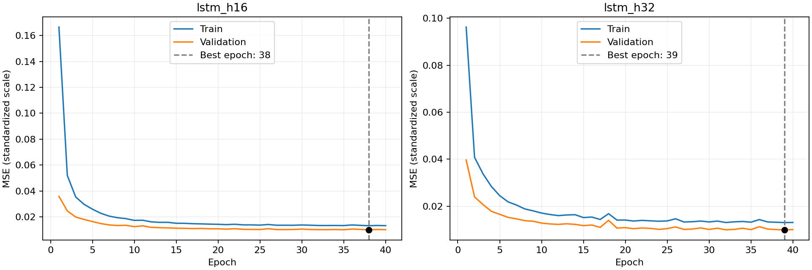
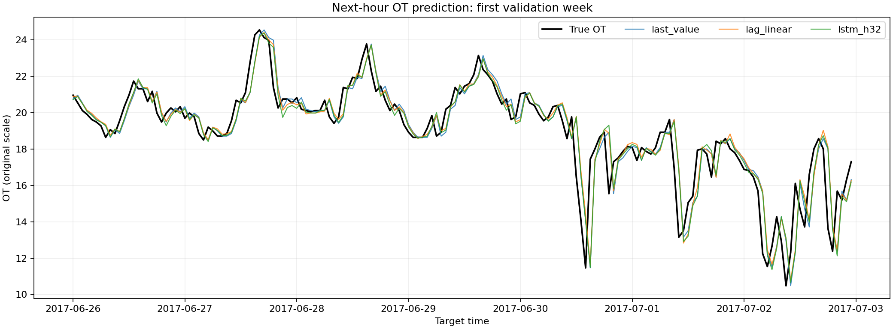

# 第七周：RNN 与 LSTM 序列预测

通过五步标量 RNN 观察状态递推、共享参数和 BPTT，再用单层 LSTM 完成过去 24 小时油温预测下一小时。

## 数据与运行

复用 `week06/data/ETTh1.csv`，来源为 [ETDataset 官方仓库](https://github.com/zhouhaoyi/ETDataset)。不重复保存数据。
建议 Python 3.10 或更高版本，使用仓库已有虚拟环境。在仓库根目录运行：

```bash
.venv/bin/python week07/run_rnn.py
.venv/bin/python week07/run_lstm.py
.venv/bin/python -m unittest week07.test_core -v
```

也可以 `cd week07` 后使用对应解释器运行 `run_rnn.py`、`run_lstm.py`。支持 `python -m week07.run_rnn` 和 `python -m week07.run_lstm`。路径按脚本位置解析，与工作目录无关。
若环境缺少依赖，在已激活的虚拟环境执行 `python -m pip install -r week07/requirements.txt`。
本机线性基线预测时，NumPy/Accelerate 会发出 `matmul` 的 divide/overflow/invalid 警告；未屏蔽警告。已复用第六周的独立逐项乘加和最小二乘复核，所有预测有限且数值一致，具体最大差见实际结果。

两个实践独立运行；结果写入 `week07/results/`，只更新 README 中各自的实际结果段。导入组件不会自动训练。

## 组件与接口设计

| 文件 | 职责 |
|---|---|
| `data.py` | 复用第六周校验、窗口、按目标时间划分；计算训练时段 μ/σ，创建 float32 张量 |
| `models.py` | LSTM 前向和训练前形状检查；明确 `output[:, -1, :]` 进入线性输出层 |
| `training.py` | 清梯度、前向、损失、反传、更新；整集评价；深拷贝并恢复最佳参数 |
| `evaluation.py` | 复用误差公式；从落盘逐行预测核对目标、真值、完整覆盖和汇总指标 |
| `reporting.py` | 绘图与 README 结果段更新，不负责训练或选择 |
| `run_rnn.py` | 五步共享标量参数演示、一次反向、顺序对照、独立复核第 2 步 |
| `run_lstm.py` | 连接数据、两组训练、验证选择、基线、测试、模型保存和结果核对 |
| `test_core.py` | 用有限差分检验 RNN 梯度；检查时间边界/统计量与窗口状态独立性 |

关键接口 `prepare_data()` 同时返回 `raw` 与 `tensors`：前者保留原始尺度窗口、目标索引和时间，供基线与对齐使用；后者只供 LSTM 使用。这能避免把线性模型按列标准化与 LSTM 的单序列标准化混淆。
`fit_lstm(model, tensors)` 只接收训练、验证集，返回历史与最佳轮次，并恢复模型参数；测试评价由入口在配置选择后执行。

## 实践一的计算与阅读位置

输入来自最前 6 小时 OT，统一 `z=(u-u[0])/10`，前 5 个输入，第 6 个为目标。`z` 独立创建为可求导叶张量。
`run_rnn.trace_rnn` 循环外创建参数，循环内重复使用同一组 `wx=0.6, wh=0.5, b=0`；`h=tanh(wx*z+wh*h_prev+b)`。
`.item()` 只保存记录，不会接回状态计算。最后用 `0.8*h5+0.1` 生成预测。只调用一次 `backward()`，不使用优化器。
顺序对照按原始位置 `[1,4,3,2,5]`，对应代码零基下标 `[0,3,2,1,4]`；从零状态开始，仅前向，梯度列留空。

<!-- RNN_START -->
原顺序预测 `-0.396435384222`，目标 `-0.935700035095`，平方损失 `0.290806363681`。

参数梯度：`dL/dwx=-0.616943487946`、`dL/dwh=-0.293198759869`、`dL/db=0.926310036992`。

第 2 步独立核对：`h1=tanh(0.6×0.000000000)=0.000000000`，
`h2=tanh(0.6×-0.274399948+0.5×h1)=-0.163168329`，与张量计算一致。

顺序对照的预测为 `-0.368080657585`。差异从第 2 步进入：
原输入 `-0.274399948`，对照输入 `-0.548699951`。
到最后一步两组当前输入相同，但上一状态分别为 `-0.421819253`、
`-0.310407726`，通过 `wh*h_prev` 影响末状态。

五个输入梯度依次为 `[0.014993260628152495, 0.02998652125630499, 0.061613432593518765, 0.13084985827053786, 0.31834294944689356]`，记录在原顺序的五行中。
本例第一个输入虽为零，仍有非零梯度；输入数值和损失敏感程度不是同一概念。
`z1→h1→h2→h3→h4→h5→预测→损失` 是早期输入的依赖路径。
同一 `wh` 在各步使用，其梯度汇总多处贡献；首步 `h0=0`，该处贡献为零。
末状态通过固定的 `0.8*h5+0.1` 连接预测。未更新任何参数，不能把本例称为训练结果。
<!-- RNN_END -->

## 实践二的固定实验设置

- 只使用前 14400 条记录的 OT，检查连续递增、无重复、数值有效。窗口内从旧到新排列。
- 先生成 24 小时窗口，再按目标时间划分。train `[2016-07-01,2017-06-26)`，val `[2017-06-26,2017-10-24)`，test `[2017-10-24,2018-02-21)`。
- μ/σ 来自原始训练时段，每时刻只计一次，`std(ddof=0)`。输入和目标均标准化，预测后反变换评价。
- 单层、单向、input_size=1、batch_first=True、dropout=0、proj_size=0。H=16/32，输出层不加激活。
- CPU、float32；Adam lr=0.001、weight_decay=0，其余默认；batch_size=128、drop_last=False、num_workers=0；两组各完整训练 40 轮。
- 每组创建模型前 `torch.manual_seed(42)`；各组 DataLoader 新建种子 42 的生成器。只打乱训练窗口，窗口内部顺序不变。
- 每个窗口的 h/c 为零初态，不传递上一批状态；这不会重置模型权重。
- 每轮结束 eval + no_grad 重新评价完整训练、验证集，按总平方误差/总目标数汇总标准化 MSE。
- 每组以最小验证 MSE 保存深拷贝，完全相同保留较早轮次；训练满后恢复。再以原始尺度验证 RMSE 选择宽度，相同选 16。
- 训练、验证比较四种方法；测试只包含两种基线和选定 LSTM。不重做 Ridge/PCA 搜索，不合并重训。
- 评价场景为获得每小时真实观测后预测下一小时；验证、测试可使用已发生的真实观测，但不更新参数。

## 实际结果与一次预测

<!-- LSTM_START -->
实际环境：Python 3.12.15，PyTorch 2.14.1，NumPy 2.2.5，pandas 2.3.3，scikit-learn 1.7.2；CPU、float32、CPU 线程数 1。

原始训练时段共有 8640 个观测，均值 `μ=17.128261698227`，总体标准差 `σ=9.176491024944`。
训练 / 验证 / 测试样本数：8616 / 2880 / 2880。

训练前同一批 128 条真实样本的检查：

- `lstm_h16`：input `[128, 24, 1]`，output `[128, 24, 16]`，h_n `[1, 128, 16]`，c_n `[1, 128, 16]`，prediction `[128, 1]`；参数共 **1233** 个。
- `lstm_h32`：input `[128, 24, 1]`，output `[128, 24, 32]`，h_n `[1, 128, 32]`，c_n `[1, 128, 32]`，prediction `[128, 1]`；参数共 **4513** 个。

形状依次表示 `(批量,时间,特征)`、`(批量,时间,隐藏宽度)`、`(层数×方向数,批量,隐藏宽度)`、同形状的细胞状态和每样本一个预测。
两组均通过 `output[:,-1,:] == h_n[0]` 的数值核对。`c_n` 到 `h_n` 还需经过 tanh 和输出门，不能直接将两者当作相同表示。

指标全部为原始油温尺度；两组 LSTM 均来自各自最佳验证轮次：

| 模型 | 时段 | 样本数 | 最佳轮次 | MAE | RMSE |
|---|---|---:|---:|---:|---:|
| last_value | train | 8616 | — | 0.736563 | 1.066672 |
| last_value | val | 2880 | — | 0.608238 | 0.925271 |
| last_value | test | 2880 | — | 0.420152 | 0.592978 |
| lag_linear | train | 8616 | — | 0.718913 | 1.043134 |
| lag_linear | val | 2880 | — | 0.598923 | 0.910183 |
| lag_linear | test | 2880 | — | 0.422645 | 0.584538 |
| lstm_h16 | train | 8616 | 38 | 0.730946 | 1.051687 |
| lstm_h16 | val | 2880 | 38 | 0.600201 | 0.914489 |
| lstm_h32 | train | 8616 | 39 | 0.719675 | 1.047373 |
| lstm_h32 | val | 2880 | 39 | 0.597546 | 0.914154 |
| lstm_h32 | test | 2880 | 39 | 0.448564 | 0.609383 |

H=16 与 H=32 的验证 RMSE 分别为 `0.914489`、`0.914154`，按规则选定 **lstm_h32**。
选定模型验证 RMSE 减去最近值为 `-0.011118`，减去线性回归为 `+0.003971`；负值表示误差更低。
成绩差异只反映本次划分和训练设置；即使优于最近值，也可能只利用了最近几步，不能据此证明学会长距离依赖。
结构允许早期信息传入、预测对早期信息敏感、早期信息改善误差，是三个不同层次；本实验未追加消融来验证后两者。

一次真实预测：目标下标 `8640`，时间 `2017-06-26 00:00:00`；
输入为下标 `8616～8639`，时间 `2017-06-25 00:00:00` 至 `2017-06-25 23:00:00` 的 24 个真实油温。
使用训练 μ/σ 标准化后，LSTM 从零 h/c 逐步读取，形成 `(1,32)` 末步隐藏表示；
其前四个分量为 `[0.5407209992408752, -0.6473445296287537, 0.04666735976934433, 0.5181053280830383]`。
线性层得到标准化预测 `0.390374660`，乘 σ 加 μ 后为 `20.710531267`，真实目标为 `20.962999344`。
这些隐藏分量是通过预测损失学习的表示，不能逐个解释成某一小时油温；固定宽度末态也可能弱化部分历史。

基线使用 `week06.models.last_value/build_linear` 重新生成，训练范围和目标完全相同。
线性回归按训练窗口的各列拟合标准化，目标不标准化；它不使用 LSTM 的 μ/σ。
独立数值复核：线性预测最大差 `1.42e-14`，系数最大差 `0`。

逐条核对通过：54624 条预测、11 行指标、80 行训练历史；目标无重复或遗漏。 模型从磁盘恢复后的全部验证预测逐项一致。测试集未用于选择，也未合并训练验证集重训。




<!-- LSTM_END -->

## 结果文件

| 文件 | 内容 |
|---|---|
| `results/rnn_trace.csv` | 两组各五步，包含指定十列；只有原顺序填写输入梯度 |
| `results/history.csv` | 两组各40轮，train_mse/val_mse 均为标准化尺度，scale 列注明 |
| `results/metrics.csv` | 11行；模型/时段/样本数/宽度/最佳轮次/原始尺度MAE与RMSE/选定LSTM标志 |
| `results/predictions.csv` | 54624条原始尺度逐目标预测，保留原始索引和目标时间 |
| `results/loss_curves.png` | 两组完整训练验证曲线及各自最佳轮次 |
| `results/validation_predictions.png` | 验证首周168个目标，真实值、两种基线、选定LSTM |
| `results/selected_lstm.pt` | 选定模型最佳 state_dict、隐藏维数、最佳轮次、μ/σ与窗口配置 |

模型加载示例（仓库根目录）：

```python
import torch
from week07.models import OilLSTM

saved = torch.load('week07/results/selected_lstm.pt', map_location='cpu', weights_only=True)
model = OilLSTM(saved['hidden_size'])
model.load_state_dict(saved['state_dict'])
model.eval()
# raw_window 是按时间从旧到新排列的24个真实油温。
x = torch.tensor((raw_window - saved['mean']) / saved['std'], dtype=torch.float32).reshape(1, 24, 1)
with torch.no_grad():
    prediction = model(x).item() * saved['std'] + saved['mean']
```

窗口长度决定读多少步，隐藏维数决定每步状态宽度，层数决定每步堆叠几层；三者不同。
MLP 的不同输入位置通常对应不同权重；RNN/LSTM 沿时间共享更新参数。隐藏表示通过预测标签学习，与 PCA 保留输入方差的线性方向不同，不能简单称为降维。
LSTM 以 `c=f*c_prev+i*g` 管理保留与写入，以 `h=o*tanh(c)` 管理读出；门由输入与上一隐藏状态计算，最终损失训练门控参数，无需门值标签。
若要研究长历史是否有用，可设计最近6小时与24小时在相同验证目标上的公平比较，或保持最近6小时不变而改动更早输入；本任务不追加这些训练，且输入改动的分布与预测误差都需要考虑。

本次交付完成本地代码、运行和检查；未执行 Git commit、push 或 GitHub 网页提交确认。
