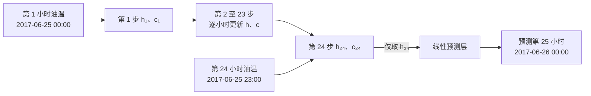
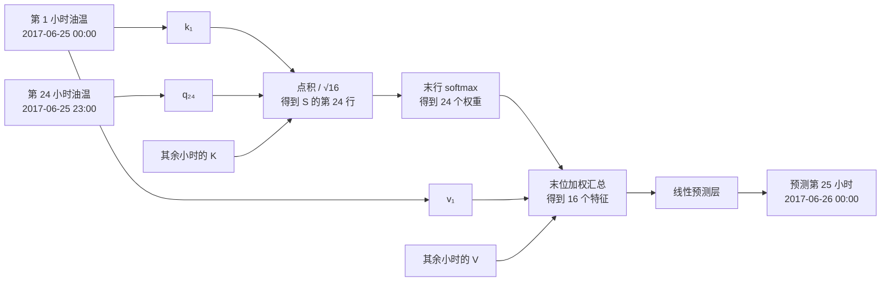
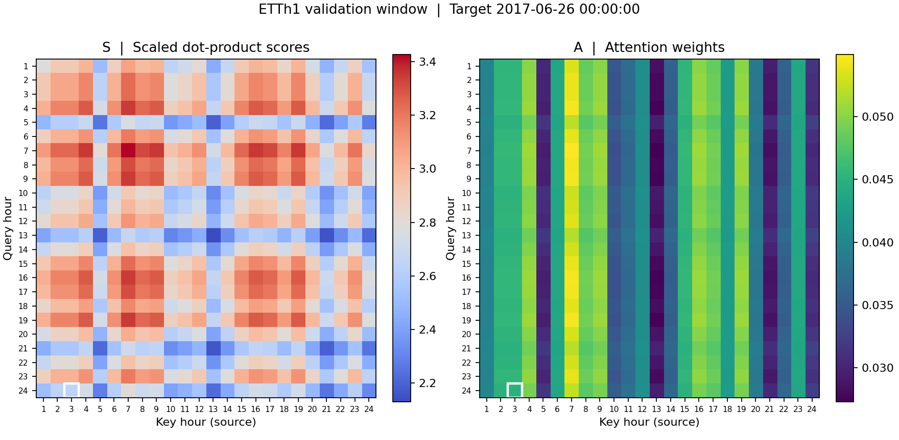

# 第八周 · 从 LSTM 到自注意力

用 ETTh1 的前 24 小时油温预测第 25 小时。本周训练一个单头自注意力模型，并复用其最佳参数完成权重替换和位置交换。

## 运行方法

从仓库根目录运行，使用现有 Python 环境，依赖 PyTorch、NumPy、pandas 和 Matplotlib。若沿用仓库的 `.venv`，可以把命令中的 `python` 替换为 `.venv/bin/python`。

```bash
python -m week08.run
python -m week08.run --evaluate-only
```

第一条命令训练 40 轮并完成三项实践。第二条载入已经保存的最佳模型，只重跑验证、热图和两项对照。数据取自 [ETTh1.csv](../week06/data/ETTh1.csv)，对照模型取自[第七周选定的 LSTM](../week07/results/selected_lstm.pt)。

## 实践一 · 同一个历史观测怎样影响预测

**初始方案。** 先把求平均作为简单对照。每个位置的权重固定时，输入变了也不会重新分配权重。为使每次读取能随输入变化，让第 24 小时的查询与每个小时的键比较，再用这次算出的权重汇总各小时的值。

### 同一个验证窗口的两条路径

取验证集第一个目标（原始下标 8640）。第 1 小时为 **2017-06-25 00:00**，第 24 小时为 **2017-06-25 23:00**，第 25 小时为 **2017-06-26 00:00**。

**LSTM 路径**



**单头自注意力路径**



LSTM 的预测层接收末步隐藏状态，第 1 小时的信息沿着后续状态更新传递。自注意力中，`scores = (query @ key.transpose(-2, -1)) / 4` 让 `k₁` 参与匹配，`readout = weights @ value` 把 `v₁` 加入第 24 小时的读出。第 2 至 23 小时各自提供 K 和 V，计算无需沿时间逐步更新。

### 模型与程序核对

- 输入是标准化油温，逐小时映射到 16 维，初版不带位置。标准化使用训练时段原始观测的均值 `17.128261698227` 和总体标准差 `9.176491024944`。训练、验证分别有 8,616 和 2,880 个窗口。
- CPU 单线程，种子 42，批次 128，Adam 学习率 0.001，共 40 轮。按最小标准化验证 MSE 保存，平局保留较早轮次。最佳是 **第 37 轮**。本周的训练、选模和误差统计使用训练集和验证集。
- 最佳模型为 [best_attention.pt](results/best_attention.pt)，每轮误差见 [history.csv](results/history.csv)。代码接口 `OilAttention.attend(x)` 返回同一次前向的 Q、K、V、S、A、Z，用于核对矩阵关系和作图。正常调用 `model(x)` 时只返回预测。
- 第一批 `backward()` 后，Q、K、V 权重梯度的范数分别为 0.015163、0.023007、4.560299。V 层参数 `weight[11, 3]` 的梯度为 −0.620567，参数在反向前后都为 −0.150055，执行 `step()` 后变为 −0.149055。复制参数只用于比较，V 仍在计算图上参与训练。
- 两个小时的输入油温完全相同时，逐小时共享的线性层会算出相同的 K 和 V。面对同一个末位 Q，它们也分到相同的权重。初版没有从输入里拿到它们分别处于升温还是降温阶段的信息。

### S/A 对照热图



纵轴是查询小时，横轴是被查询小时。图中目标时间为 **2017-06-26 00:00**。第 24 行、第 3 列的分数 **2.643790**，softmax 后的权重 **0.045051**。第 24 行权重之和为 **1.000000**。用末行权重逐项乘 V 后求和，还原 Z 末行的 16 个分量，最大绝对差 **5.96 × 10⁻⁸**，浮点容差内一致。

## 实践二 · 替换注意力权重（动手）

**运行前判断。** 平均读应得到 24 个 V 向量逐列求平均。如果这段窗口各小时的油温比较接近，预计替换后读回的向量和预测变化不大。只读最后一小时应当读回末时刻的 V，随后仍经过训练好的线性预测层。第七周的最近值基线直接用第 24 小时的真实油温。哪种替换更偏离原预测要结合原权重和各 V 的差异判断；哪种预测更准还需要和真值比较。

**计算核对。** 在单窗口及各验证批次中，原权重汇总与模型末位输出一致，原权重复算可还原原预测；平均读的向量与 V 沿时间轴的均值一致；只读最后一小时的向量与末小时的 V 一致。

| 目标时间 | 真实油温 | 原权重预测 | 平均读预测 | 只读最后一小时预测 |
|---|---:|---:|---:|---:|
| 2017-06-26 00:00 | 20.963000 | 20.558067 | 20.505848 | 20.030360 |

这个窗口的油温在 20.541～21.878 之间。平均读与原预测只差约 **0.0522**，而只读末小时比原预测低约 **0.5277**。原权重在这一个窗口上最接近真值。整段验证集上，只读末小时的 MAE 和 RMSE 都低于原权重，平均读的两项误差都高于原权重。这些对照使用同一个已训练模型。

在单头计算图中，替换的是 **Softmax 通向第二个 MatMul** 的末行权重。V 从另一条箭头进入同一个 MatMul；V 越相近，改变配比对汇总结果的影响就可能越小。

## 实践三 · 交换两个小时并加入位置（动手）

**运行前判断。** 交换前 23 小时中的两个观测时，末小时的输入和查询保持原样。没有位置时，两对 K/V 和对应权重一起交换，末位汇总应在浮点误差内相同。加入位置后，位置向量留在原时刻，交换的是油温。两组「内容 + 位置」改变，预测有可能变化。

在同一个窗口，交换前 23 小时中油温最高和最低的两个观测。第 7 小时（2017-06-25 06:00）的油温为 **21.878000**，第 13 小时（2017-06-25 12:00）为 **20.541000**。

| 前向设置 | 交换前预测 | 交换后预测 | 末位汇总的最大分量差 |
|---|---:|---:|---:|
| 未加位置 | 20.558066 | 20.558066 | 1.49 × 10⁻⁸ |
| 加入位置 | 20.186755 | 20.184666 | 0.001648 |

未加位置时，第 7、13 小时的权重从 **0.052370、0.029564** 交换为 **0.029564、0.052370**，末位查询保持相同，预测在浮点容差内一致。加入位置后，在 16 维输入向量的第一个分量上加 `(小时编号 - 1) / 23`。位置加号的两路输入是**逐小时的油温向量**和**该时刻的位置向量**，位置留在原时刻。相加后才计算 Q、K、V，使模型可以对油温与位置的新组合产生不同的读出。加位置后同一设置内的交换使预测变化约 **0.002089**。这一检查复用原参数，交换过的窗口不计入验证指标。

## 验证指标

以下四行使用同一批验证目标，按原始油温尺度计算。

| 模型或读法 | 验证样本数 | MAE | RMSE |
|---|---:|---:|---:|
| 第七周选定的 LSTM | 2880 | 0.597546 | 0.914154 |
| 本周自注意力，原权重 | 2880 | 1.238918 | 1.594348 |
| 同一自注意力模型，平均读 | 2880 | 1.497818 | 1.966358 |
| 同一自注意力模型，只读最后一小时 | 2880 | 0.862231 | 1.138599 |

第七周选定的 LSTM 在本次验证集上两项误差最低。本周模型给早期观测提供了更直接的计算路径，这次验证误差仍高于 LSTM。

原始记录见[窗口观察](results/observations.json)、[验证预测](results/validation_predictions.csv)和[验证指标](results/validation_metrics.csv)。
