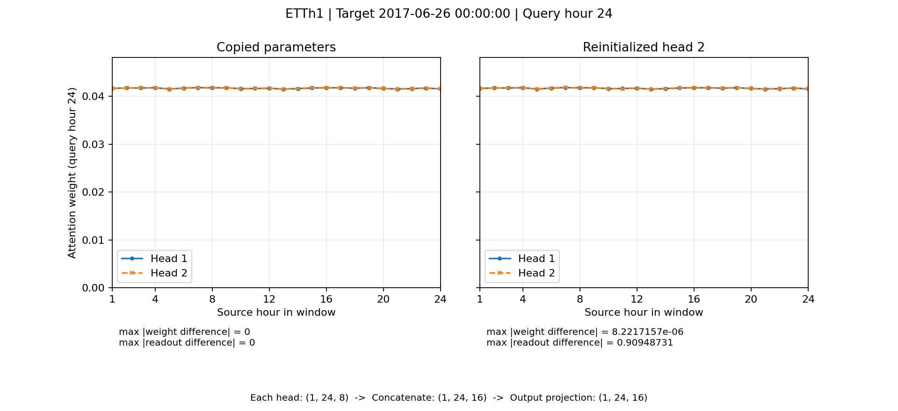

# 第十周 · 双头注意力、因果遮罩与单层编码器

目前实现实践四至六。实践四比较双头的权重和读出；实践五固定参数验证因果遮罩；实践六组装一层编码器，训练油温预测模型。均使用 CPU、随机种子 42。实践四、五仅做评价模式下的无梯度前向计算；实践六训练 40 轮并恢复验证集最优参数。

## 运行

从仓库根目录执行：

```bash
.venv/bin/python -m week10.run_practice4
.venv/bin/python -m week10.run_practice5
.venv/bin/python -m week10.run_practice6
.venv/bin/python -m week10.run_practice6 --evaluate-only
```

也可以使用已经安装依赖的 `python`。依赖沿用仓库环境：PyTorch、NumPy、pandas、Matplotlib。数据使用 [ETTh1.csv](../week06/data/ETTh1.csv)，训练时段标准化逻辑复用 [week07/data.py](../week07/data.py)。实践四、五需要已有的[第八周最佳模型](../week08/results/best_attention.pt)，只载入参数，不会重训第八周。实践六从头训练，比较以前模型时读取 [week08 的逐条验证预测](../week08/results/validation_predictions.csv)。`--evaluate-only` 不训练，载入本周最佳模型，复算验证指标和首个窗口预测。

## 建议阅读顺序

1. [models.py](models.py) 的 `AttentionHead`：三个 `16 → 8` 线性层生成 Q、K、V，再计算 `scores → weights → readout`，分别对应分数 S、权重 A、读出 Z。
2. [run_practice4.py](run_practice4.py) 的 `main()`：定位原窗口，复用第八周输入映射；找到 `load_state_dict` 复制参数和 `AttentionHead()` 只替换第二头的位置。
3. 回到 `TwoHeadAttention.forward()`：找到 `torch.cat(..., dim=-1)` 和 `output_projection`，看两份读出怎样合并。
4. `summarize()`：找到 `[0, 23]`，理解如何取第 24 小时的权重和读出，计算最大绝对差。

两个头都接收完整的 X，每个头的 Q、K、V 都是独立的可学习投影。只复用第八周模型的输入映射 `embed`，没有使用第八周的注意力投影或预测层。和第八周实践一保持一致，本实验不加位置编码。

## 同一个验证窗口

| 项目 | 内容 |
|---|---|
| 原始目标下标 | 8640，验证集第一个目标 |
| 第 1 小时 | 2017-06-25 00:00 |
| 第 24 小时 | 2017-06-25 23:00 |
| 预测目标时间 | 2017-06-26 00:00 |

窗口的原始油温、标准化油温与时间保存在 [practice4_window.csv](results/practice4_window.csv)，后续实践五可复用这个窗口。

## 两组实测对照

差值均比较两个头第 24 小时的对应向量，使用 `(向量1 - 向量2).abs().max()`。

| 设置 | 权重最大绝对差 | 读出最大绝对差 |
|---|---:|---:|
| 第二头复制第一头全部参数，包括偏置 | 0 | 0 |
| 只重新初始化第二头 | 8.22171569 × 10⁻⁶ | 0.90948731 |

第一组说明：输入和参数相同，两头的权重和读出分别相同。

第二组说明：这次随机初始化得到的两排权重非常接近，但读出有明显差异；V 投影也发生了变化，因此不能仅根据权重接近就判断读出相同。未训练的两个头不能被命名为“升温头”或“降温头”。



两幅图共用横纵轴刻度，横轴为窗口内第 1–24 小时，纵轴为第 24 小时读取各小时的权重。这次曲线基本重合，具体差异以图下数值为准。目标时间为 2017-06-26 00:00。拼接前每头为 `(1, 24, 8)`，拼接后为 `(1, 24, 16)`。

## 张量形状与计算核对

| 张量 | 形状 | 含义 |
|---|---|---|
| 原始标准化输入 | `(1, 24, 1)` | 一条窗口，24 个油温 |
| X | `(1, 24, 16)` | 使用原输入映射后的特征 |
| 每头 Q、K、V | `(1, 24, 8)` | 每小时分别生成查询、键、值 |
| 每头 A | `(1, 24, 24)` | 行是查询位置，列是被读取位置 |
| 每头 Z | `(1, 24, 8)` | `A @ V` 的读出 |
| 拼接结果 | `(1, 24, 16)` | 沿特征轴拼接两份 Z |
| 输出投影 M | `(1, 24, 16)` | `16 → 16` 线性层混合特征 |

程序核对：权重非负且每行之和接近 1；手动加权求和能还原第 24 行读出；复制参数后完整 A、Z 分别完全一致；更换第二头后第一头结果保持不变；拼接保留全部 24 行且前后各 8 维对应各自的头。上述核对已通过。

完整数值与末行向量见 [practice4_observations.json](results/practice4_observations.json)，差值表见 [practice4_differences.csv](results/practice4_differences.csv)。重新运行会覆盖本实验的结果文件。本实验没有训练和保存新的最佳模型，输出投影也尚未训练。

## 实践五 · 改第 18 小时，检查第 6 行

入口为 [run_practice5.py](run_practice5.py)。可以单独运行，不要求先运行实践四；它用相同的窗口和初始化顺序，复现实践四第二组的双头参数。先复制标准化输入，仅令 `changed[0, 17, 0] += 1`，再分别经过相同的输入映射。这个增量相当于原始油温增加训练集标准差，约 9.176491。

遮罩实现在 [models.py](models.py) 的 `AttentionHead.forward()`：

```python
if use_causal_mask:
    t = scores.size(-1)
    future = torch.ones(t, t, dtype=torch.bool, device=scores.device).triu(1)
    scores = scores.masked_fill(future, float('-inf'))
weights = torch.softmax(scores, dim=-1)
```

`triu(1)` 标记对角线上方的未来位置，`masked_fill` 先将这些位置的分数设成负无穷，再做 softmax，使未来权重为 0，允许读取的位置权重总和仍为 1。双头模块将同一个开关传给两个头。默认 `use_causal_mask=False`，实践四原有调用保持有效。

`main()` 中只创建一套模型，遮罩开/关、原窗口/副本共四次前向计算始终使用相同参数。比较的是输出投影之后的 `output[0, 5, :]`，共 16 个数。下面的权重来自原窗口第一头的第 6 行。

| 遮罩开关 | 第 18 列权重 | 未来列最大权重 | 整行权重和 | 原窗口与副本的第 6 行输出最大绝对差 |
|---|---:|---:|---:|---:|
| 关 | 0.04168282 | 0.04179285 | 1.00000000 | 0.01223826 |
| 开 | 0 | 0 | 0.99999994 | 0 |

关闭遮罩时，第 6 行可以读取第 18 小时，其 K、V 改变后，第 6 行输出也发生变化。打开遮罩时，第 6 行只能读取前 6 小时，改动的第 18 小时无法影响它；整行权重和在浮点误差范围内为 1。

程序检查两个头在两份输入上的权重归一化、未来权重严格为零、对角线仍可读取，并核对第 1～17 行不会被第 18 小时影响。另检查第 24 行在遮罩开关前后保持一致，因为它没有窗口内的未来位置。实践五核对已通过；修改公共模块后重跑实践四，完整数值记录与修改前一致。

结果文件：

- [practice5_comparison.csv](results/practice5_comparison.csv)：上表的实测数值。
- [practice5_inputs.csv](results/practice5_inputs.csv)：两份标准化输入，只有第 18 小时不同。
- [practice5_observations.json](results/practice5_observations.json)：窗口时间、修改位置、增量，以及两头第 6 行的权重和合并后输出。输出差值属于内部特征，没有油温单位。

原 Transformer 图右下方的 Masked Multi-Head Attention 用这种规则限制译文侧只能读取已有词；中间的交叉注意力再用译文查询读取已知的源句。我们的最终油温任务在第 24 小时末预测第 25 小时，前 24 次观测都已经取得，因此实践六关闭窗口内的因果遮罩。

## 实践六 · 组装编码器并训练

建议按以下顺序阅读：

1. [models.py](models.py) 的 `OilEncoder.__init__()` 创建输入映射、双头注意力、两个 LayerNorm、前馈网络和预测层。
2. `OilEncoder.encode()` 按 `X → M → H → F → E → last → prediction` 计算；`forward()` 只取最终预测，训练时直接调用 `model(x)`。
3. [training.py](training.py) 的 `fit()` 执行清梯度、前向、MSE、反向和参数更新，记录每轮损失并恢复最佳参数。
4. [run_practice6.py](run_practice6.py) 的 `main()` 准备数据；`train()` 先核对接线再训练和保存；`evaluate()` 重新载入最佳模型，验证和保存单窗口记录。

模型使用原论文图中的 Post-LN 顺序：

```python
X = embed(x) + position
M = attention(X, use_causal_mask=False).output
H = norm1(X + M)
F = feed_forward(H)  # 16 → 32 → ReLU → 16
E = norm2(H + F)
prediction = predictor(E[:, 23, :])
```

其中前馈网络的实际运算顺序是 `Linear(16, 32) → ReLU → Linear(32, 16)`。位置编码只在第一个特征上加入 `(t - 1) / 23`。所有可学习层独立随机初始化，包括输入映射和两个头，不载入第八周参数，也不复制两头参数。固定位置编码作为 buffer 随模型保存，不参与训练。

### 数据、训练与梯度

沿用 ETTh1 原划分：训练窗口 8,616 条，验证窗口 2,880 条。只对原始训练时段的 8,640 条观测计算均值和总体标准差，分别为 17.1282616982271、9.176491024944335。标准化目标与预测形状均为 `(B, 1)`。

CPU 单线程，种子 42，批次 128，Adam 学习率 0.001，训练 40 轮。每轮用评价模式计算标准化训练和验证 MSE，按最低验证 MSE 保存参数；同分保留较早轮次。只使用训练集和验证集，不计算测试指标。

首批反向后检查全部可学习参数都有有限梯度，特别记录第一头 Q 权重和最终预测层权重：

| 参数 | 梯度形状 | 梯度范数 | backward 后最大参数变化 | step 后最大参数变化 |
|---|---|---:|---:|---:|
| 第一头 Q 权重 | `(8, 16)` | 0.00740468 | 0 | 约 0.001 |
| 预测层权重 | `(1, 16)` | 5.84068298 | 0 | 约 0.001 |

说明同一个末端损失能传回注意力头；`backward()` 计算梯度，`step()` 才更新参数。

### 同一个窗口的形状与预测

| 中间结果 | 实测形状 |
|---|---|
| X、M，第一处加法前 | 均为 `(1, 24, 16)` |
| H、F，第二处加法前 | 均为 `(1, 24, 16)` |
| E，完整编码器输出 | `(1, 24, 16)` |
| last，取第 24 行 | `(1, 16)` |
| prediction | `(1, 1)` |

最佳模型在第 **33 轮**，标准化验证 MSE 为 **0.00974073388534**。同一首个验证窗口的目标时间为 2017-06-26 00:00，标准化预测为 **0.38327384**，还原后的预测为 **20.64537065**，实际油温为 **20.96299934**。

### 验证指标与文件

下面均为同一批 2,880 个验证目标，MAE、RMSE 使用原始油温尺度。以前模型的预测通过目标下标、时间和真值逐项核对后复用，最近值基线直接取每条窗口的末次观测。

| 模型 | 验证 MAE | 验证 RMSE | 来源或最佳轮次 |
|---|---:|---:|---|
| 最近值基线 | 0.608238 | 0.925271 | 每条窗口第 24 小时油温 |
| 第七周 LSTM | 0.597546 | 0.914154 | week08 验证预测中的 lstm 列 |
| 第八周单头模型 | 1.238918 | 1.594348 | week08 验证预测中的 attention 列 |
| 第十周单层编码器 | 0.594753 | 0.905675 | 第 33 轮 |

这次编码器两项验证误差略低于已有 LSTM。多个组件共同改变，结果反映整个模型的预测表现，不能据此单独归因于多头、位置编码或其他某个组件。

- [best_encoder.pt](results/best_encoder.pt)：最佳参数、模型配置、标准化统计量、训练配置和首批梯度记录。
- [practice6_history.csv](results/practice6_history.csv)：全部 40 轮的标准化训练、验证 MSE。
- [practice6_validation_predictions.csv](results/practice6_validation_predictions.csv)：每个验证目标及四个模型的原始尺度预测。
- [practice6_validation_metrics.csv](results/practice6_validation_metrics.csv)：四个模型的误差和来源。
- [practice6_observations.json](results/practice6_observations.json)：最佳轮次、形状、首批梯度和单窗口预测记录。

已核对模型重新载入后的结果、单窗口与批量预测的一致性、两处残差、最佳轮次与最小验证 MSE 的对应关系，以及保存预测重算的 RMSE 与最佳标准化 MSE 的换算关系。实践四、五也已重跑，完整数值记录与修改前一致。
